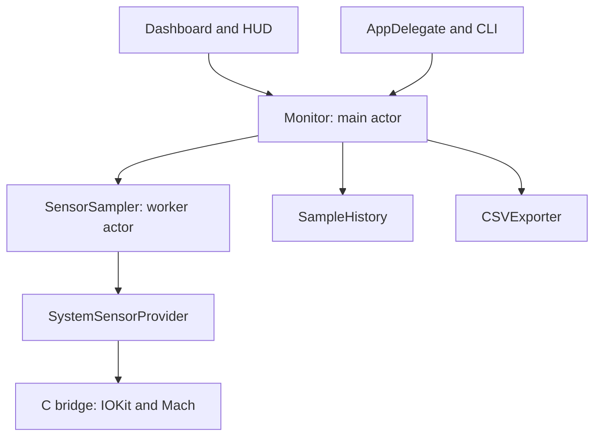

# Architecture and engineering decisions

ThermoBar is a local, read-only macOS utility with no third-party package dependencies.

## Ownership and concurrency

`Monitor` owns settings and published UI state on the main actor. It starts a cancellable polling task and receives immutable, `Sendable` snapshots. Changing the polling configuration cancels the previous loop; a cancelled loop cannot publish its in-flight result. The task captures the monitor weakly and is cancelled when the monitor is released.

`SensorSampler` serializes discovery, reads, connection recovery, CPU baselines and power transitions. A provider is transferred into the actor on initialization. Production uses exactly one system provider because the C bridge has process-wide SMC and CPU state. Tests use separate in-memory providers and never open live services. The system provider closes its SMC connection on release.

Views own presentation choices. `HUDPresentation` contains miniwindow geometry and display formatting. `CSVExporter` is pure serialization; `CSVExportDialog` owns the AppKit save dialog.

## Missing data and recovery

Discovery retains candidate temperature keys independently of their current values. A temporarily unavailable value is omitted from a snapshot, while its key remains eligible for the next read. Incomplete discovery is retried. A complete discovery is refreshed every five minutes, rather than on every sample. When every selected sensor fails, the connection is closed and discovery restarts on a subsequent poll.

Temperature grouping is a heuristic based on SMC key names, not a manufacturer-provided sensor map. Finite readings between 0 and 130 °C are accepted. This is a plausibility filter, not a hardware safety specification.

CPU utilization is a delta of cumulative counters. The first reading after measurement resumes, or after a long gap, primes the baseline and is shown as unavailable. This avoids presenting a long hidden interval as current CPU load.

## Power transitions

IORegistry can report an adapter state change before updating current and voltage. `PowerTransitionFilter` hides the old battery flow until a timestamp advances, comparable finite electrical values change, or previously missing electrical data becomes available. Missing values, including `NaN`, are never evidence of a changed value. A temporarily unknown source does not erase the last known source.

If the timestamp remains unavailable and electrical values do not establish freshness, the UI keeps waiting. It does not release a possibly stale value after an arbitrary timeout. Zero battery flow on battery power is valid; positive charging flow without external power is suppressed.

## History and exports

`SampleHistory` retains the last two hours relative to each new sample. Reset clears the session. CSV uses ISO 8601 timestamps, POSIX decimal formatting, empty fields for unavailable values, and quoted/escaped text fields. Export is explicit and written atomically to the chosen file. Both CPU and GPU contribute to the chart scale.

## Verification boundaries

`./test.sh` tests pure models, actual C power decoding and the sampler through fixture providers. Tests cover both regressions found in the initial review, connection recovery, load resumption, power transitions, history retention, CSV and chart ranges. CI runs these tests, the C static analyzer and an app build. Swift 6 checks actor isolation and sendability; builds treat Swift compiler warnings as errors.

`--self-test` is a separate live integration check. It depends on compatible hardware and AppleSMC access and therefore is not a hosted CI requirement. A passing smoke test verifies current availability and CSV structure, not the accuracy of undocumented hardware fields. Physical adapter transitions, sleep/wake and window interactions still require manual testing on a real Mac.
